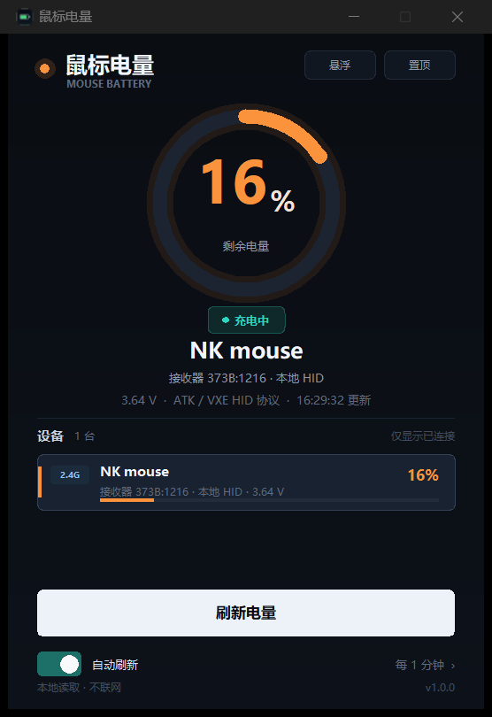
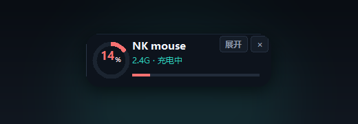

# 鼠标电量

一个 Windows 上的小型电量查看器。深色单窗口，打开即读，支持自动刷新。



## 下载

到 [Releases](https://github.com/qwr79/mouse-battery/releases) 下载 `鼠标电量-v1.0.0-win64.zip`，
解压后双击 `鼠标电量.exe` 即可。免安装、不需装 Python。

## 先说你的设备

这台电脑上检测到的鼠标是 **NK mouse NANO dongle**（`VID 373B: PID 1216`），
走的是 **2.4G USB 接收器**，并不是蓝牙连接。本项目已经适配了它的 HID 电量协议，
所以打开就能读到电量。

同时，程序也会读取 Windows 为**蓝牙设备**维护的电量属性。不过 Windows 在设备断开后
仍会保留上一次的电量，所以程序只显示**当前确实连接着**的蓝牙设备，避免把缓存值当成实时电量。

## 功能

- 大号环形电量，一眼看清；颜色随电量变化（绿 / 黄 / 橙 / 红）
- 插线充电时显示「充电中」
- 悬浮窗模式：置顶小卡片，随时看电量
- 2.4G 鼠标、蓝牙设备统一列表，点击任意设备切换显示
- 30 秒 / 1 分钟 / 5 分钟自动刷新，或仅手动刷新
- 置顶、刷新快捷键（`F5`）
- 窗口位置、刷新设置自动保存
- 完全本地读取，不联网、不上传、不写日志
- 免安装绿色版，无需安装 Python

## 悬浮窗

点击主界面右上角的「悬浮」，就会收成一张置顶小卡片：



- 拖动卡片空白处可以移动
- 点「展开」或双击卡片回到主界面
- 点「×」退出；悬浮位置会被记住
- 下次启动会保持上次的窗口形态

## 直接运行

解压后双击文件夹里的 `鼠标电量.exe`。

- 第一次打开会立即读取一次电量。
- 如果读数提示鼠标没有响应，动一下鼠标或按一下键，再点「刷新电量」。
- 电量低时建议及时充电；2.4G 鼠标休眠时第一次读取可能会失败。

从源码运行：

```powershell
python main.py          # 打开界面
python main.py --once   # 命令行读一次
python main.py --json   # 输出 JSON，便于脚本调用
```

环境要求：Windows 10/11，Python 3.10+（仅源码运行需要，自带 tkinter）。

## 支持范围

| 设备 | 读取方式 | 状态 |
|---|---|---|
| ATK / VXE / NK 2.4G 鼠标（`VID 373B`、`3554`） | 厂商 HID Output Report 协议 | 已在 `373B:1216` 上实测 |
| 蓝牙鼠标 / 耳机 / 手柄等 | Windows 蓝牙电量 PnP 属性 + 当前连接过滤 | 属性读取已验证 |
| 其他 2.4G / 有线鼠标 | — | 暂不支持私有协议 |

蓝牙电量来自 Windows 协议栈收到设备上报后写入的属性。设备没连接、没上报，
或厂商驱动没有把电量交给 Windows 时，就读不到；这不是程序能绕过的限制。
**设备断开后属性仍然存在，所以程序会再查一次蓝牙连接状态，只展示已连接的设备。**

## 实现原理

### 2.4G ATK / VXE 鼠标

接收器暴露一个 Usage Page 为 `0xFF05` 的 HID 接口，输入 / 输出报告均为 64 字节。
发送：

```text
08 7D 72 02 00 01 07 01 00 ... 00
```

收到以 `08 72 ... 07` 开头的回复后，第 7 字节就是电量百分比；第 8–9 字节
（小端）是电压，单位 mV。程序用独立的 overlapped 读句柄收报告，
避免在同一个句柄上同时阻塞读和写。

### 蓝牙设备

枚举 `BTHENUM` / `BTHLE` 设备节点，读取未公开属性：

```text
PROPERTYKEY {104EA319-6EE2-4701-BD47-8DDBF425BBE5}, 2
```

Windows 会把 HFP / HID 设备上报的电量写在这里。按蓝牙地址把同一设备的多个
服务节点合并，再用 `BluetoothFindFirstDevice` 检查 `fConnected`，只显示当前
连接的设备；断开后残留的缓存值会被直接过滤掉。

### 充电状态

这款鼠标的 64 字节协议里没有可靠的充电标志：实测拔掉充电线后，第 6 字节仍然是 `1`。
所以程序用连续采样的电量和电压趋势判断：

- 电量上升，或 45 秒以上电压上升 ≥ 8 mV：标记为「充电中」
- 电量下降，或电压下降 ≥ 8 mV：取消「充电中」

插线后通常需要 1–3 个刷新周期才会显示，不是硬件直读。如果电量/电压长时间
完全不变，可能会继续显示「电量很低」。这种情况是协议限制，不是漏读了状态。

## 自己构建

```powershell
# 安装构建依赖
python -m pip install -r requirements-build.txt

# 一键打包（生成 release\鼠标电量\ 和 zip）
powershell -ExecutionPolicy Bypass -File .\build.ps1
```

打包使用 PyInstaller，产物是免安装绿色文件夹（`鼠标电量.exe` + `_internal`）。
图标资源在 `assets/`。

## 常见问题

**显示「未检测到 2.4G 接收器」**
：确认接收器插在 USB 口上；换一个 USB 口；拔插后点刷新。

**显示「鼠标没有响应」**
：鼠标可能休眠了。动一下鼠标、按一下键，等两秒再刷新。

**蓝牙设备不显示**
：先在 Windows 设置 → 蓝牙和设备中确认设备处于已连接状态，并且系统里能看到电量。
设备断开后，Windows 仍会保留上次电量；本程序会检查连接状态，不会把缓存值当实时值显示。

**插着充电线还显示电量很低**
：这款鼠标没有直接上报充电位，程序靠电量和电压的趋势推断。插线后等 1–3 分钟，
或者多点几次刷新。若电量/电压长时间完全不变，可能会判不出来。

**被厂商驱动占用**
：如果同时开着品牌鼠标驱动，HID 接口可能被独占。退出驱动后重试。

**开机自启**
：本程序没有写入启动项。需要的话，把 `鼠标电量.exe` 的快捷方式放进
`shell:startup` 即可。

## 隐私

- 只调用 Windows 自带的 `setupapi` / `hid` / `user32`，不访问网络。
- 不写日志，不保存设备地址或电量历史；设置文件只包含窗口位置和刷新间隔。
- 设置保存在 `%APPDATA%\MouseBattery\settings.json`。

## 参考

协议思路和 Windows 蓝牙电量属性线索来自这些开源项目，代码为独立实现：

- [yszyszysz233/2.4G-battery-viewer](https://github.com/yszyszysz233/2.4G-battery-viewer)
- [SpartanX1/bluetooth_classic_battery_windows](https://github.com/SpartanX1/bluetooth_classic_battery_windows)
- [o0Zz/PeripheralBatteryMonitor](https://github.com/o0Zz/PeripheralBatteryMonitor)
- [joric/bluetooth-battery-monitor](https://github.com/joric/bluetooth-battery-monitor)

## License

MIT，见 [LICENSE](LICENSE)。
